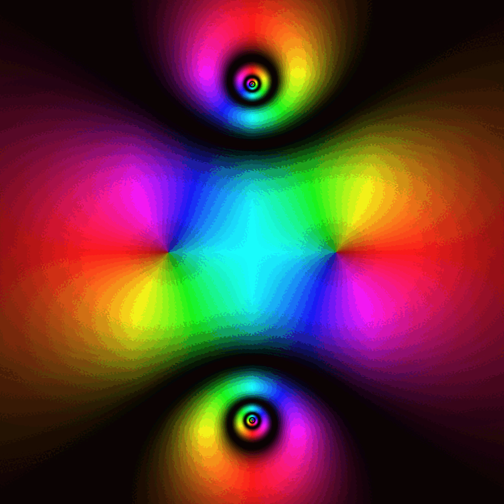
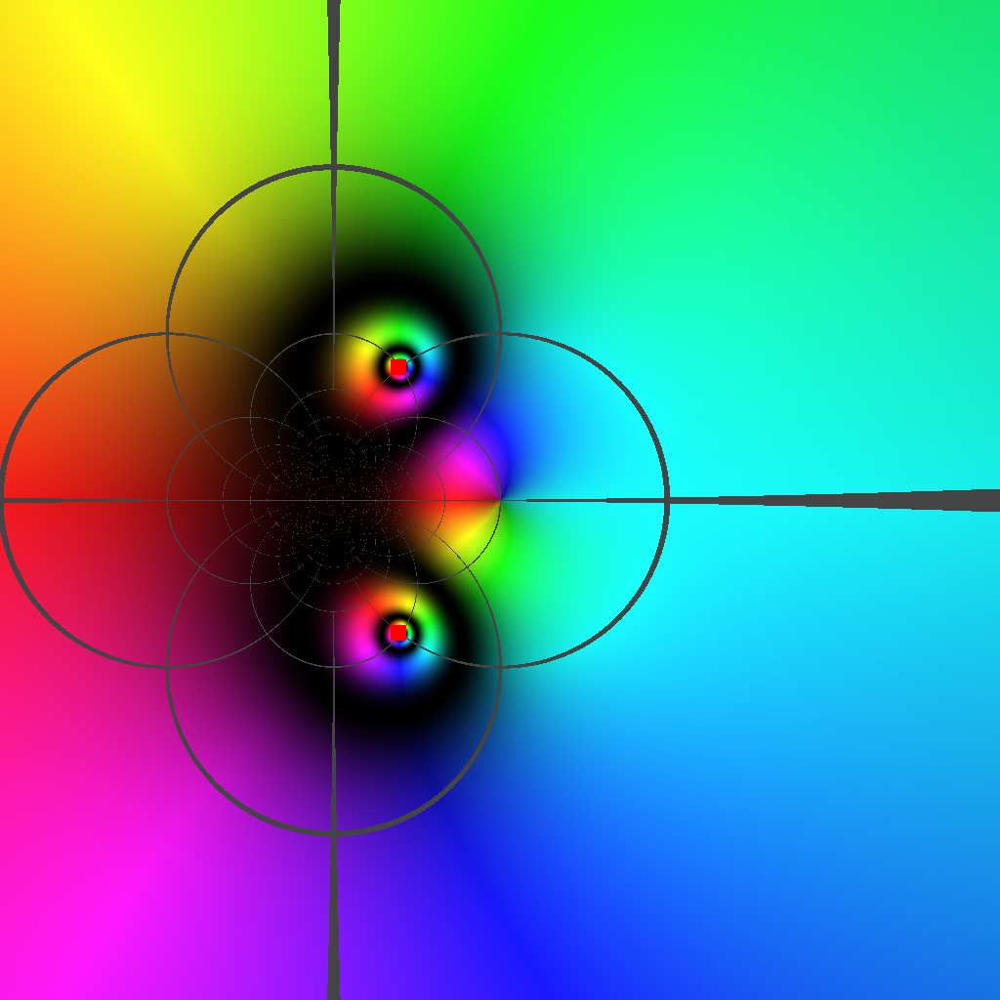

# CX-Viz: High-Performance Complex Function Visualizer

CX-Viz is a C++23 application that visualizes complex mathematical functions (like `(z*z - 1)/(z*z + 4)`) using **Domain Coloring**. It uses an **Adaptive Quadtree** algorithm to render high-detail regions (like poles and zeros) efficiently, while keeping the rest of the image smooth.



## 🚀 Features
- **Mathematical Visualization:** Visualizes arbitrary complex functions using custom Domain Coloring (Hue = Argument, Brightness = Magnitude).
- **DSA Optimized:** Uses a Max-Heap (Priority Queue) based Quadtree for Best-First spatial partitioning. Calculates only where needed, reducing CPU load by >90%.
- **Modern C++ (C++23):** 
  - Uses C++23 **Modules** (`import cx.core`) for cleaner dependencies.
  - Uses `std::mdspan` for safe 2D image buffer access.
  - AST (Abstract Syntax Tree) using `std::variant` for parsing math expressions.
- **Animation:** Features a smooth zoom-in effect directly into the singularity (pole).

## 🛠️ Build Instructions (macOS/Linux)
Requires `Clang 17+` (with C++23 module support), `CMake 3.28+`, and `Ninja`.

## 🌌 Conformal Mapping (Möbius Transformation)
CX-Viz also supports Möbius transformations (e.g., `w = (z-1)/(z+1)`). This visually demonstrates how conformal maps preserve angles and map straight lines into perfect circles. The grid overlay helps visualize the distortion caused by the transformation.



```bash
cmake -S . -B build -G Ninja -DCMAKE_BUILD_TYPE=Release
cmake --build build -j